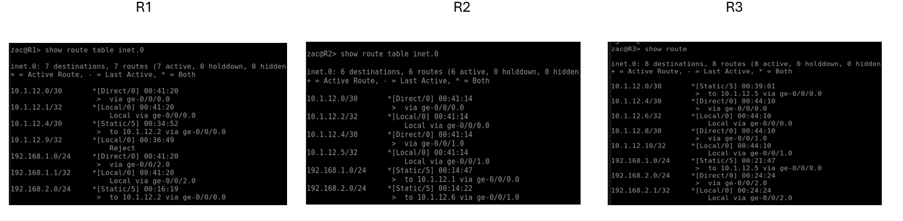
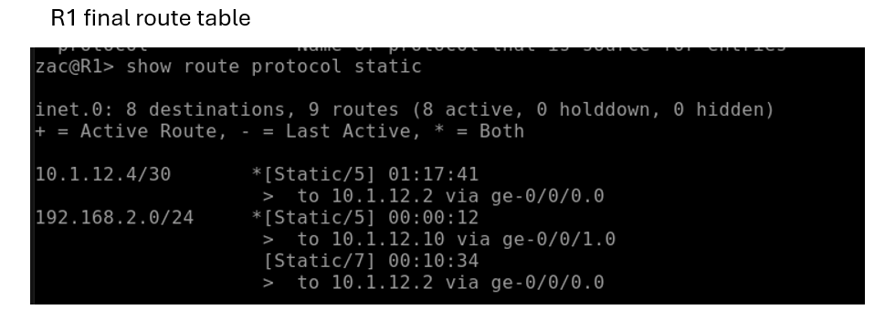

# Lab 01 Static Routing

## Overview

This lab aims to explore static routing including configuring next-hop routes, back-up static routes and route selection. 

The configuration for each router is supplied in this repository which can be found within the configuration/ directory. 

## Equipment

- EVE-NG Community Edition (version: )
- 3 x Juniper vRouters (version: ) 

## Topology

## IP Scheme 

## Lab Walkthrough

**1. Initial configuration**
 
   Basic router administration tasks, interface configuration, IP addressing and static route configuration.

**2. Initial connectivity**
   
   Analysing routes between the LANs by inspecting the routing tables on all three routers:

   

  This shows that the only route between the R1 LAN and R3 LAN is through R2 - as the link between R1 and R3 is disabled at first. 

**3. Verify connectivity**
   
   Verifying the connectivity between R1 LAN and R3 LAN using the ping operation:

   (insert image here at a later date)

**4. Link failure scenario**
   
   This explores the scenario where the link between between R2 and R3 fail's:

   

   The main problem here is that R1 has no information about the link between R2 and R3 which leads to R1 continuously using this route, even          though a link is down along its path. This highlights a limitation with static routing where it receives no updates about links within the          topology leading to packet loss due to loss of connectivity. 

**5. Solution** 

This issue can also be attributed to the topology as there are no redundant or back-up links within this network. The solution is to introduce an extra link between R1 and R3 which introduces redundancy into the network, allowing for link failures while minimizing the loss of end-to-end connectivity. 

As the link between R1 and R3 was already previously configured but disabled, the next step is enable this interface to allow traffic to pass through it. If we analyze the topology the route between R1 and R3 is more efficient as the LANs are directly attached to the routers after taking one hop as compared to the route R1-R2-R3 which requires an extra hop in comparison. 

Instead of configuring two static next-hop routes with equal preferences, the route R1–R2–R3 was configured as a qualified-next-hop with a preference of 7. This means that when both paths are available, R1 will prefer the direct route between R1 and R3, which has the default static route preference of 5.

If the direct R1–R3 link fails, R1 will use the qualified-next-hop through R2 as an alternative path. Once the direct link is restored, R1 will revert to using the direct route due to its lower preference value.

## Further Investigation 

While configuring this lab I encountered some interesting behaviour when pinging the end devices connected to the R1 LAN and R3 LAN.

When I first configured this lab I forgot to include a gateway on both VPCs, which led to some interesting behaviour. When I tried to ping PC2 from R1, it worked, although there was a large delay in time for each individual ping request, which only increased with each ping sent.

After configuring the gateways on both VPCs, the ping requests returned to normal response times.

Therefore, in a future lab I will explore why the ping request was still successful, but experienced such a large delay, even though there was no gateway configured on the PC devices.

