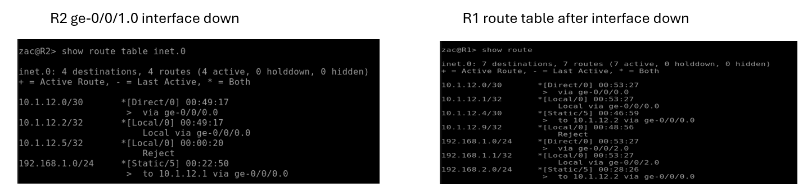

# Lab 01 Static Routing

## Overview

This lab aims to explore static routing including configuring next-hop routes, back-up static routes and route selection. 

The configuration for each router is supplied in this repository which can be found within the configuration/ directory. 

## Equipment

- EVE-NG Community Edition (version: )
- 3 x Juniper vRouters (version: ) 

## Topology

## IP Scheme 

## Lab Walkthrough

1. **Initial configuration**
   Basic router administration tasks, interface configuration, IP addressing and static route configuration.

2. **Initial connectivity**
   Analysing routes between the LANs by inspecting the routing tables on all three routers:

   

  This shows that the only route between the R1 LAN and R3 LAN is through R2 - as the link between R1 and R3 is disabled at first. 

3. **Verify connectivity**
   Verifying the connectivity between R1 LAN and R3 LAN using the ping operation:

   (insert image here at a later date)

4. **Link failure scenario**
   This explores the scenario where the link between between R2 and R3 fail's:

   
   
