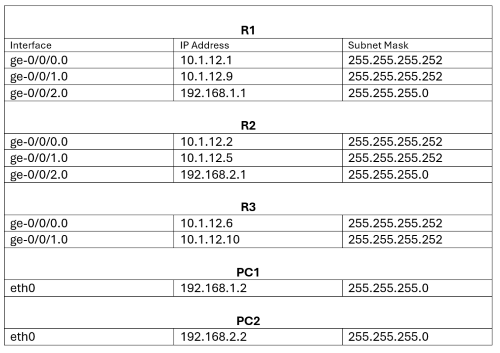

# Lab 01 Static Routing

## Overview

This home lab aims to explore static routing including back-up static routes, route selection and recursive routes. It will also include several failure scenarios which will show my methodology for diagnosing and resolving network faults. 

The configuration for each router is supplied in this repository which can be found within the configuration/ directory. 

## Equipment

- EVE-NG Community Edition (version: )
- 3 x Juniper vRouters (version: ) 

## Topology

## IP Scheme 

## Lab Walkthrough

1. For the purposes of this lab it should be noted that the link between R1 and R3 will be configured but disabled, therefore at the beginning, the only route between R1 and R3 is through R2.

2. Before beginning, there was some basic administration tasks configured on the router's which included setting a root authentication password, changing the hostname and creating a local user.

3. After this the router's were all configured according to the topology and IP scheme provided above which included configuring interfaces, creating a static route's (only through R1-R2-R3 at this point, avoiding R1 to R3) and setting up the VPC devices. The image provided below shows the routing tables for R1, R2 and R3 at this point:

