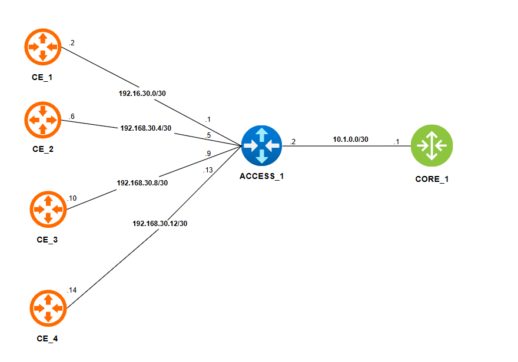
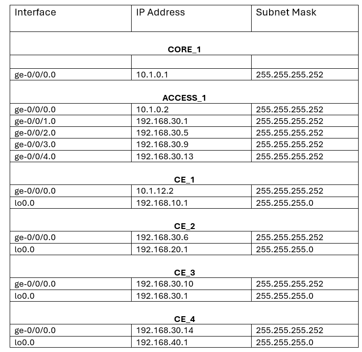

# Lab-02 Aggregate Routes

## Overview

This lab aims to explore aggregate routes and how these specially crafted routes can be used to summarise multiple routes into a single route advertisement.

It will include a base configuration which does not use aggregate routes which will act as a point of comparison to the configuration which includes route aggregation.  

## Equipment

- EVE-NG Community Edition (version: )
- 4 x Juniper vRouter (version: )

## Topology

This topology contains four customer edge routers which are connected to their ISPs access router, which is connected to a core router. The main goal will be to summarise the customer prefixes using an aggregate route to be advertised up to the core. 

## IP Scheme

## Lab Walkthrough
